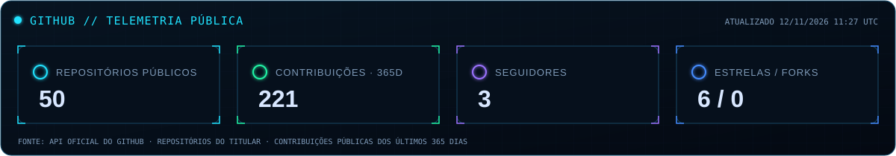
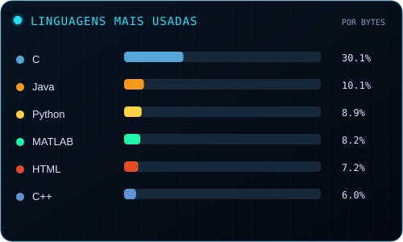
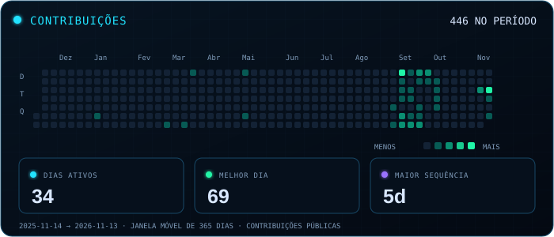

  <strong><a href="https://7dsolv.github.io/konaet-atlas/">ABRIR O ATLAS INTERATIVO ↗</a></strong>
  &nbsp; · &nbsp; <a href="#código-aberto-para-explorar">Código</a>
  &nbsp; · &nbsp; <a href="#biblioteca">Biblioteca</a>
  &nbsp; · &nbsp; <a href="#conexões">Conexões</a>

**Adilson Oliveira · @7dsolv · São Paulo, Brasil**

Construo sistemas para transformar curiosidade em código. **KONAET** conecta engenharia de software, inteligência artificial, matemática e experimentação.

O [Atlas](https://7dsolv.github.io/konaet-atlas/) reúne mapa navegável, pesquisa de projetos, PDFs e referências salvas no seu dispositivo. Este perfil apresenta o caderno; o portal oferece a navegação interativa.

## Código aberto para explorar

| Percurso | Projetos |
| --- | --- |
| Sistemas | [KONAET Cover](https://github.com/7dsolv/konaet-cover) · [KONAET Horizon](https://github.com/7dsolv/konaet-os) |
| Inteligência artificial | [IA Neural](https://github.com/7dsolv/IA_Neural) · [AGIMatematic](https://github.com/7dsolv/AGIMatematic) |
| Ciência | [Realidade Quântica](https://github.com/7dsolv/RealidadeQuantica) · [Caderno de matemática](https://github.com/7dsolv/matematic-latex-github) |
| Ferramentas | [KONAET Bot](https://github.com/7dsolv/konaet-bot) · [KONAET X-Ray](https://github.com/7dsolv/konaet-xray) |

[Experimentar IA Neural](https://7dsolv.github.io/IA_Neural/) · [Abrir X-Ray](https://7dsolv.github.io/konaet-xray/) · [Todos os repositórios](https://github.com/7dsolv?tab=repositories)

Cada projeto tem seu estágio de desenvolvimento. Código, testes e limites estão nos respectivos repositórios. Fabricação e ensaios físicos dos projetos de hardware continuam pendentes.

## Biblioteca

[KONAET OS — Guia de Engenharia](./publications/konaet-os-engineering-guide.pdf) · [Manual técnico integral](./publications/konaet-os-complete-technical-manual.pdf) · [Acervo de pesquisas](https://drive.google.com/drive/folders/13K20ctDlS_xR-s3Zp3Yle_kPhxTTYf_v?hl=pt-br)

## Conexões

[LinkedIn](https://www.linkedin.com/in/adilson-oliveira-779490283) · [Instagram](https://www.instagram.com/7dsolv) · [Hugging Face](https://huggingface.co/7dsolv) · [ORCID](https://orcid.org/0009-0007-4553-4064)

Registro de atividade pública

Gráficos gerados pelo workflow do perfil a partir dos dados públicos do GitHub, com a data da consulta em cada imagem.

